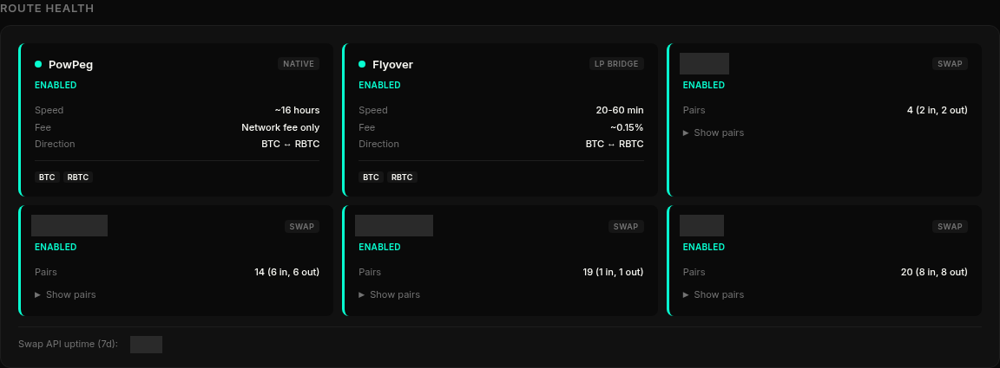
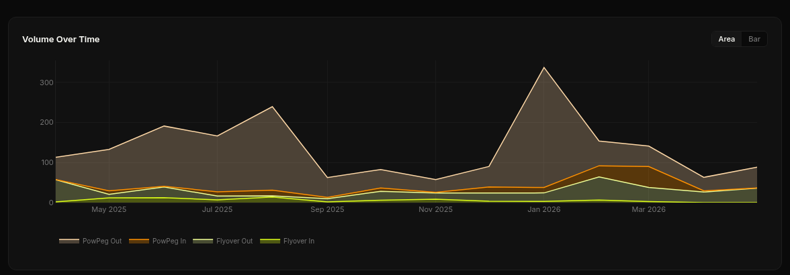

# atlas-dashboard

> **Case study.** This case study documents the May 2026 dashboard snapshot. The screenshots are historical, not current operating data.

atlas-dashboard is an independent analytics dashboard I designed and built for Rootstock bridge activity. It brings Flyover, PowPeg and swap routes into one view: volume over time, net flow, transaction size, route health, and liquidity-provider balances and activity. It also sent Telegram alerts and a daily summary.

It's separate from [Atlas](https://atlas.rootstock.io/), the Rootstock ecosystem's liquidity routing platform from RootstockLabs. I envisioned Atlas and took it from zero to one.

## What it shows

- Volume over time
- Net flow
- Transaction size
- Route health, with native bridges and swap routes side by side
- Liquidity-provider balances and activity, in one status panel
- A shared day / week / month / quarter switch across the cards

*Route health, with native bridges and swap routes side by side. Capture of the May 2026 snapshot page, taken Nov 11, 2026. Status labels shown are not a current status check. Swap-route names and the uptime value are covered.*

*Volume over time. Capture of the May 2026 snapshot page, taken Nov 11, 2026.*

---

atlas-dashboard is my independent work, not a RootstockLabs product.
